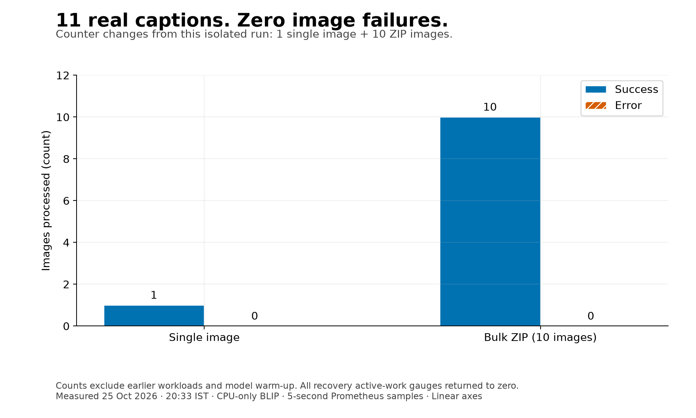
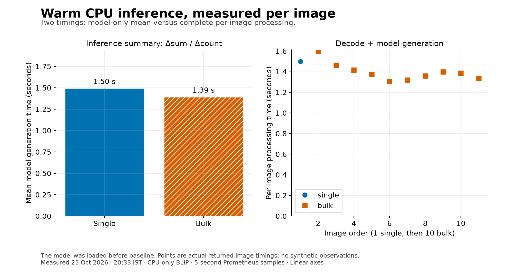
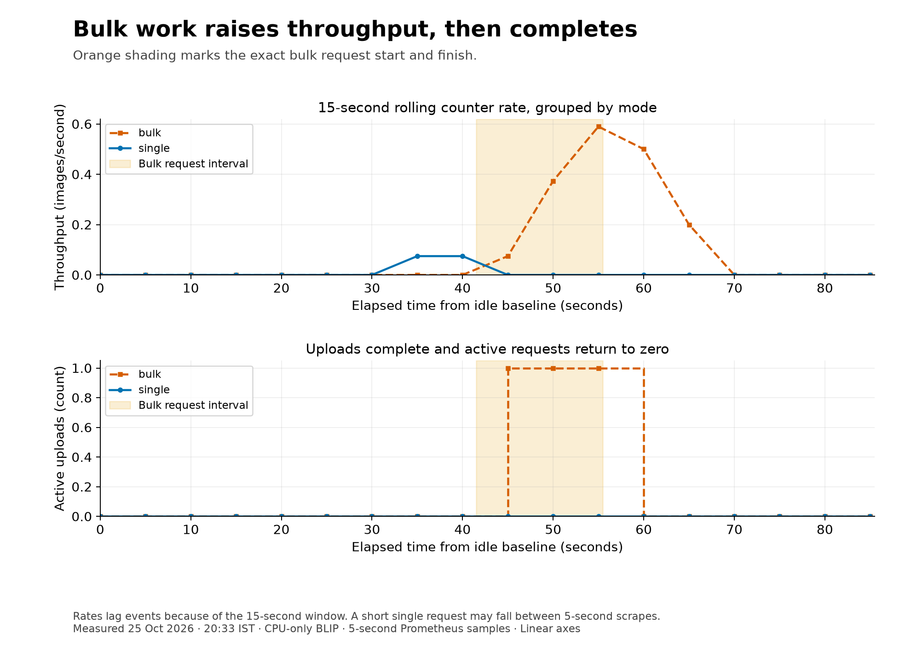
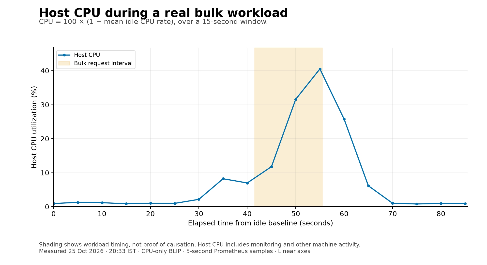
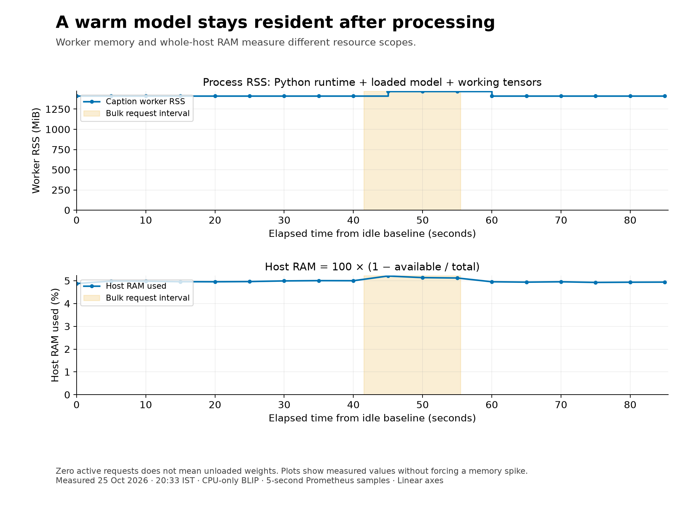

# Plots — real CPU captioning workload

Five figures for a quick assessment. Each includes a descriptive title, a short
explanation, labeled axes with units, linear scales, and a legend where needed.
Colors are supplemented by markers, line patterns or hatching for accessibility.

**Measured run:** 1 single image + 10 images in a ZIP, **11 successful captions,
0 image failures**. The already-loaded model ran on CPU. Mean generation was
**1.50 s** for the single image and **1.39 s/image** for bulk; the bulk
request took **13.97 s**. All active-work gauges returned to zero.
These are observations from one run, not a statistically significant benchmark.

| Figure | What it explains |
|---|---|
| [01 · Processing results](01_processing_results.png) | Success/failure counter increases for this run, excluding earlier requests |
| [02 · Caption latency](02_caption_latency.png) | Model-only mean latency versus actual per-image decode + generation times |
| [03 · Throughput and recovery](03_throughput_and_recovery.png) | Single/bulk processing rates and active uploads returning to zero |
| [04 · CPU and bulk activity](04_cpu_and_bulk_activity.png) | Measured host CPU alongside the exact bulk request interval |
| [05 · Memory and bulk activity](05_memory_and_bulk_activity.png) | Worker RSS and whole-host RAM; model weights remain resident after completion |

Orange shading marks the exact bulk request interval. Time-series points are
actual Prometheus observations queried at **5-second intervals**. CPU and
throughput use a **15-second rolling rate**, so changes can lag request boundaries.
A short single-image request may fall entirely between scrapes; the counter and
caption measurements still record it. Host CPU/RAM include other machine work;
correlation with bulk activity alone does not prove causation. No CPU or memory
spike was invented or forced to make the plots more dramatic.

## Reproduce the figures

`measurements.json` contains the actual captions, phase timestamps, counter
deltas, model-only mean timings and raw Prometheus time-series samples. The
images can be regenerated from this file without running the application:

```bash
python3 -m venv .venv
source .venv/bin/activate
python -m pip install matplotlib==3.11.2 requests==2.34.2 prometheus-client==0.26.0 pillow==13.0.0
python plots/generate.py
```

Plotting dependencies are optional and are not added to the application's runtime
requirements. To capture a **new** real run instead of redrawing the saved run:

```bash
docker compose up -d
python plots/generate.py --capture
```

Do not send other uploads during capture. The script warms the model if needed,
records 30 seconds idle, processes one image, waits 10 seconds, processes a
10-image ZIP, and records 30 seconds recovery. It asserts the expected image
counter deltas and zero active work before saving data and drawing the plots.
Capture takes about 90 seconds after any first model download.

The sample is a real flower photograph plus 10 brightness variants, not ten
distinct source scenes. Source: [scikit-learn sample flower photograph](https://raw.githubusercontent.com/scikit-learn/scikit-learn/main/sklearn/datasets/images/flower.jpg).
Original photographer: [vultilion](https://www.flickr.com/photos/vultilion/6056698931/),
[CC BY 2.0](https://creativecommons.org/licenses/by/2.0/), as documented in the
[upstream attribution](https://raw.githubusercontent.com/scikit-learn/scikit-learn/main/sklearn/datasets/images/README.txt).
The transformations are explicit in `generate.py`; raw photographs need not be
stored in this submission.

**AI attribution prompt for these PromQL queries:** “Measure mode throughput,
active uploads, CPU idle-rate utilization, host RAM and process RSS at 5-second
intervals; preserve raw samples and explain scope.” Exact expressions are in
`generate.py` and `measurements.json`. This plotting script only visualizes
recorded observations; it does not generate synthetic monitoring data.

## Figure gallery

### 1. Processing results



### 2. Caption latency



### 3. Throughput and recovery



### 4. CPU and bulk activity



### 5. Memory and bulk activity


